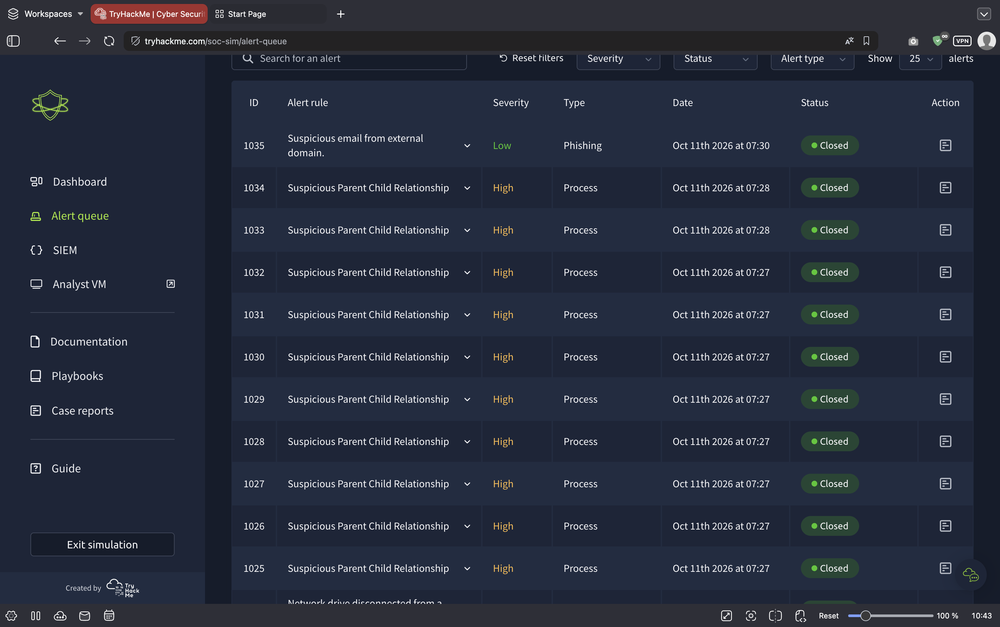
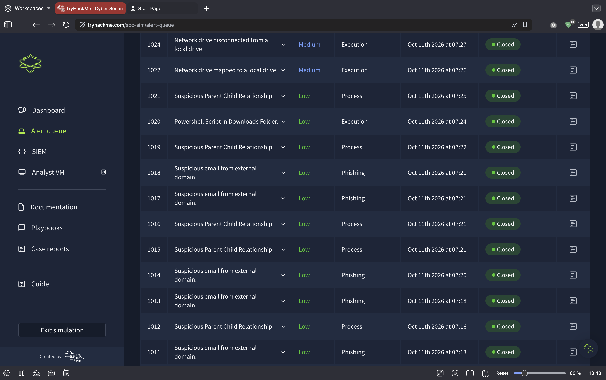
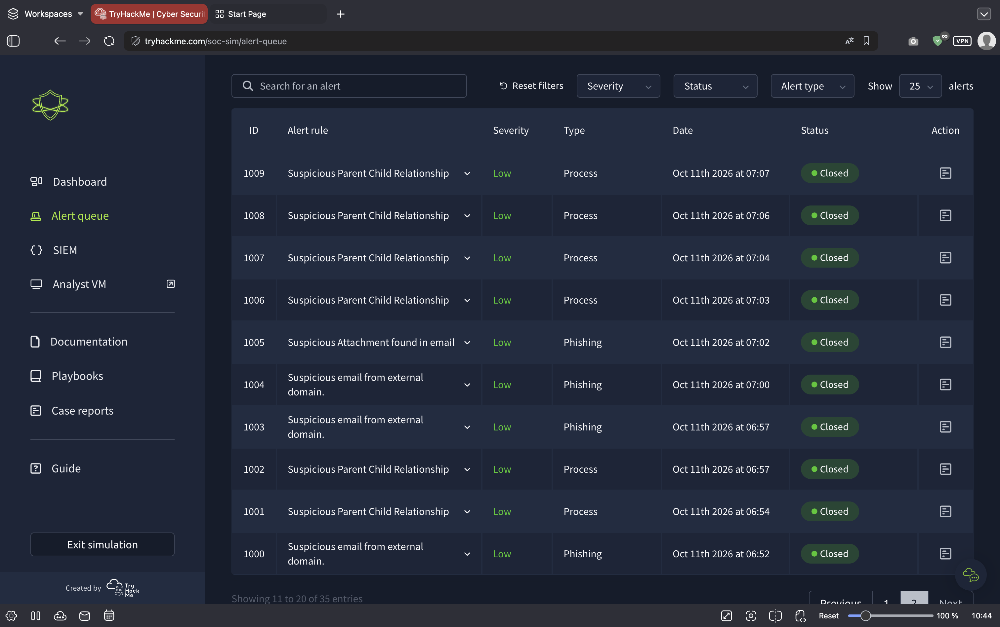
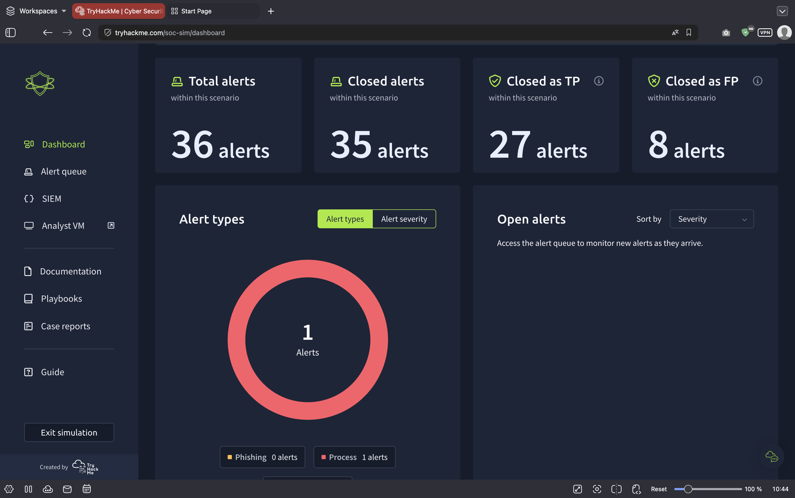
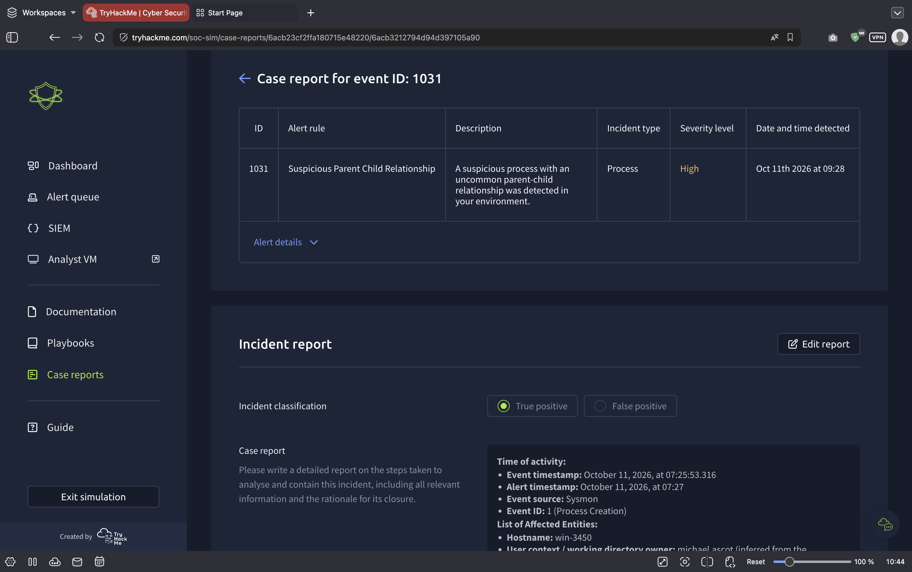
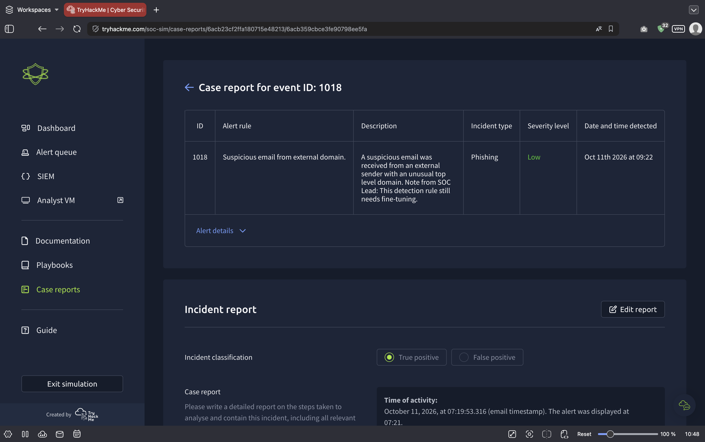
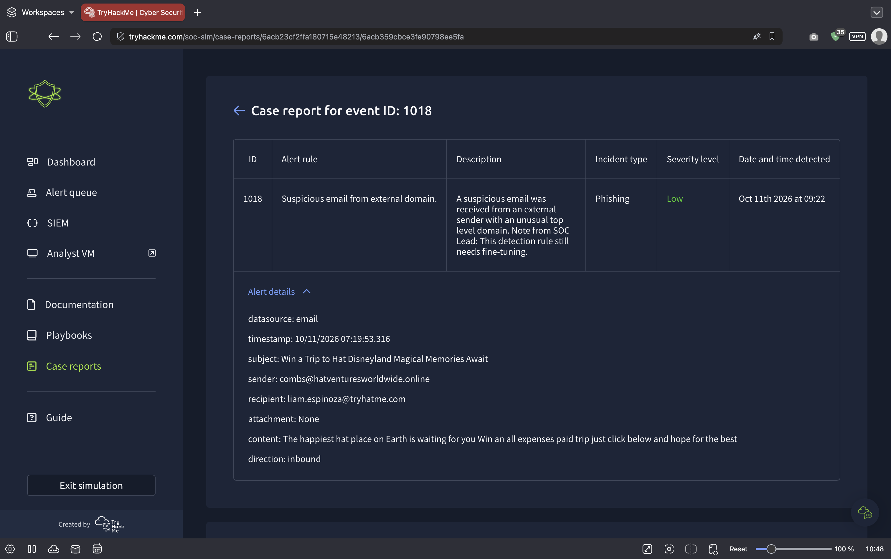

# TryHackMe SOC Simulator — "Phishing Unfolding"

**Blue Team / SOC Analyst Portfolio — Tier 1 Alert Triage, Investigation & Incident Reporting**

[](https://tryhackme.com)
[](#scenario-overview)
[](#results-at-a-glance)
[](#results-at-a-glance)
[](#results-at-a-glance)

---

## Overview

This repository documents a full **end-to-end blue team investigation** completed against the TryHackMe **SOC Simulator** — a live-fire SOC environment in which the analyst is presented with a real-time alert queue, raw telemetry, and a ticket-management workflow closely mirroring a production Tier 1/2 analyst role.

The scenario, **"Phishing Unfolding"**, begins as a low-fidelity phishing alert and escalates into a multi-stage endpoint compromise. The objective was to triage every alert in the queue, correctly discriminate true positives from false positives, reconstruct the attacker's chain of activity from raw event data, and file a defensible incident report for each confirmed detection.

**Result: simulation passed — security breach prevented.** All 30 triaged alerts were classified correctly, with 100% true positive and 100% false positive identification accuracy.

> **Simulation disclaimer** — Hostnames, usernames, domains, and email addresses referenced in this repository are fictional artefacts of the TryHackMe training environment. No production network or live customer data is involved.

---

## Results at a Glance

| Metric | Result |
|---|---|
| **Scenario** | Phishing Unfolding (SOC Simulator) |
| **Outcome** | ✅ Passed — security breach prevented |
| **Alerts triaged** | 30 |
| **True positives (correctly confirmed)** | 15 |
| **False positives (correctly dismissed)** | 15 |
| **True positive identification rate** | **100%** |
| **False positive identification rate** | **100%** |
| **MTTR (mean / median)** | **2.97 min / 2.67 min** |
| **MTTR — true positives vs false positives** | 2.76 min / 3.18 min |
| **MTTR — population σ** | 1.05 min |
| **Fastest closure** | Alert 1028 — 1.70 min |
| **Slowest closure** | Alert 1012 — 6.97 min |
| **Score** | 1,560 pts (+193 run bonus) |

Every figure above is derived from the per-alert record in the [Appendix](#appendix--per-alert-triage-record) — the raw data behind the whole write-up is in this file.

---

## Scenario Overview

**Initial vector — Phishing.** A weaponised email was delivered inbound to a corporate mailbox from an external sender using a look-alike domain, carrying a social-engineering lure with no attachment.

**Escalation — Execution.** Post-delivery activity on the affected endpoint (`win-3450`) surfaced through endpoint telemetry: PowerShell execution from a user download directory, network-drive mapping and subsequent disconnection, and a cluster of anomalous parent/child process relationships detected by the Sysmon-to-SIEM pipeline.

**Analyst objective.** Correlate phishing and endpoint telemetry into a single narrative, confirm malicious activity, suppress the high volume of low-fidelity noise, and record the investigative reasoning in a case report for each alert.

### Attack narrative reconstructed

```
[1] External inbound email  ──▶  user mailbox (liam.espinoza)
        subject: "Win a Trip to Hat Disneyland… Magical Memories Await"
        sender : combs@hatventuresworldwide.online   (typosquat TLD: .online)
        body   : credential/travel lure, no attachment, no URL pre-scan
                                          │
                                          ▼  user interaction
[2] Endpoint win-3450  ──▶  PowerShell executed from Downloads folder
                                          │
                                          ▼
[3] Anomalous parent/child process relationships  (Sysmon → SIEM)
    └─ repeated, high-frequency detections = scripted/automated activity
                                          │
                                          ▼
[4] Network drive mapped to local drive → disconnected shortly after
    └─ staging / collection behaviour on the host
                                          │
                                          ▼
[5] Containment  ──▶  alerts confirmed TP, host isolated, case reports filed
```

### Timeline (all times UTC)

| Time | Event | Stage |
|---|---|---|
| 07:19:53 | Inbound phishing email delivered to `liam.espinoza@tryhatme.com` from `combs@hatventuresworldwide.online` | 1 · Initial access |
| 07:22–07:27 | Low-severity process and phishing alerts begin filling the queue (mostly later dismissed as benign) | — |
| 07:24 | PowerShell script executed from Downloads folder → **Alert 1020** | 2 · Execution |
| 07:25:53 | Sysmon Process Creation event on `win-3450` (Event ID 1) | 3 · Process anomaly |
| 07:26 | Network drive mapped to local drive → **Alert 1022** | 4 · Staging |
| 07:27 | Alert 1031 raised — **≈66 s detection latency** from the event above | 3 |
| 07:27 | Network drive disconnected from local drive → **Alert 1024** | 4 |
| 07:27–07:30 | Burst of 11 confirmed-TP "Suspicious Parent Child Relationship" alerts (High) | 3 |
| 09:22 | Case report filed for Alert 1018 (phishing artefact review) | 5 · Documentation |

---

## Detection Engineering Findings

The most valuable output of a triage exercise is not the count of tickets closed — it is the **signal quality of the detection rules themselves**. Triaging all 30 alerts produced measurable evidence about which rules generate reliable signal and which generate noise.

### Detection yield by rule

| Detection rule | Alerts raised | Confirmed TP | Confirmed FP | Precision |
|---|---|---|---|---|
| `Suspicious Parent Child Relationship` | 22 | 11 | 11 | **50%** |
| `Suspicious email from external domain.` | 4 | 0 | 4 | **0%** |
| `Powershell Script in Downloads Folder.` | 1 | 1 | 0 | **100%** |
| `Network drive mapped to a local drive` | 1 | 1 | 0 | **100%** |
| `Network drive disconnected from a local drive` | 1 | 1 | 0 | **100%** |
| `Suspicious Attachment found in email` | 1 | 1 | 0 | **100%** |

### Detection yield by alert type

| Alert type | Alerts | Confirmed TP | Confirmed FP | TP yield | Mean TTR |
|---|---|---|---|---|---|
| Phishing | 5 | 1 | 4 | **20%** | 3.02 min |
| Process | 22 | 11 | 11 | **50%** | 3.06 min |
| Execution | 3 | 3 | 0 | **100%** | 2.27 min |

### Detection yield by severity

| Severity | Alerts | Confirmed TP | Confirmed FP | TP yield | Mean TTR |
|---|---|---|---|---|---|
| High | 10 | 10 | 0 | **100%** | 2.75 min |
| Medium | 2 | 2 | 0 | **100%** | 2.39 min |
| Low | 18 | 3 | 15 | **17%** | 3.16 min |

### Key takeaways

1. **`Suspicious email from external domain.` produced zero true positives in this run.** All four alerts raised by this rule were confirmed benign — 0% precision. A "suspicious" email arriving from an external domain is the default state of business email; the rule has no discriminating predicate. **Recommendation:** enrich with sender-domain age (newly registered domains), SPF/DKIM/DMARC failure state, look-alike/typosquat scoring against internal domains, and first-time-sender relationships before this rule is permitted to reach an analyst queue.

2. **Severity was perfectly calibrated at the top and noisy at the bottom.** All 10 `High` and both `Medium` severity detections were genuine positives (100% precision), while the 18 `Low` severity detections included 15 false positives — an 83% noise rate. Severity, not alert text, was the fastest reliable triage heuristic in this dataset. **Recommendation:** reweight severity to reflect rule precision and asset criticality rather than alert type alone.

3. **Host-level execution telemetry was the highest-quality signal.** PowerShell execution from a `Downloads` directory and network-drive map/unmap behaviour each yielded 100% precision. **Recommendation:** promote these to higher severity and pair them with automated host-isolation playbooks.

4. **`Suspicious Parent Child Relationship` is a volume generator.** It produced 22 of 30 alerts at 50% precision — high value when correlated, low value in isolation. **Recommendation:** apply correlation windows (same parent, N distinct children within a short interval), whitelist known-good maintenance pairs, and group into a single incident per host rather than one ticket per event. The alert's own description carried the SOC Lead guidance — *"This detection rule still needs fine-tuning"* — which this dataset empirically supports.

5. **False positives cost more analyst time than true positives** (3.18 min vs 2.76 min), and the slowest ticket (6.97 min) was a low-severity process alert requiring the deepest scrutiny before dismissal. Ambiguous, low-fidelity alerts consume the most effort while delivering the least value.

6. **Detection latency (~66 s) was not the bottleneck.** The environment surfaced the event quickly; analyst throughput and report precision were the variables worth improving.

---

## Investigation Methodology

Each alert followed a consistent, repeatable triage workflow — documented per-ticket in the simulator's case report field and applied across all 30 alerts.

| Step | Action |
|---|---|
| **1 · Alert validation** | Read the alert rule, severity, incident type, and detection timestamp. Confirm the alarm is not the result of a known change window or scanner activity. |
| **2 · Raw telemetry triage** | Expand *Alert details* and pull the raw fields the detection was raised on — datasource, event timestamp, source host, process lineage, user context, and any file or network artefacts. Establish facts before interpretation. |
| **3 · Entity & context enrichment** | Resolve every entity named in the alert: hostname, user account, working-directory owner, parent process name and signature, and any domains or IPs in scope. Determine whether the user and host are expected to perform this activity at this time. |
| **4 · Threat assessment** | Ask the discriminating questions: *Is this a common binary executing from an expected path? Is the parent/child relationship plausible for this software stack? Is the domain newly registered, look-alike, or free-hosted? Does the behaviour align with the phishing lure observed earlier in the scenario?* |
| **5 · Classification** | Mark the alert **True Positive** or **False Positive** with the supporting evidence, and where relevant an inferred user account for accountability. |
| **6 · Case report** | Write the incident report: activity timeline (event timestamp vs. alert timestamp — the dwell time), event source, affected entities, investigative steps, and the explicit rationale for closure. |
| **7 · Containment recommendation** | For confirmed positives, state the containment action — host isolation, account credential reset, mailbox purge of the delivery, and blocking of the sender domain. |

---

## Case Studies

### Case 1 — Alert 1018: `Suspicious email from external domain.`

| Field | Value |
|---|---|
| Incident type | Phishing |
| Severity | Low |
| Date/time detected | Oct 11 2026, 09:22 |
| Datasource | `email` |
| Event timestamp | `10/11/2026 07:19:53.316` |
| Direction | Inbound |
| Sender | `combs@hatventuresworldwide.online` |
| Recipient | `liam.espinoza@tryhatme.com` |
| Subject | *Win a Trip to Hat Disneyland — Magical Memories Await* |
| Attachment | None |
| Body excerpt | *"The happiest hat place on Earth is waiting for you — Win an all expenses paid trip, just click below and hope for the best"* |

**Analysis.** Inbound external mail, no attachment, classic prize/travel social-engineering lure. The sending infrastructure warrants attention: `hatventuresworldwide.online` is a domain assembled around the victim organisation's own brand, registered on a `.online` TLD — a combination typical of look-alike, low-cost infrastructure used for credential harvesting and initial access. **Recommendation:** treat any click-through from this delivery as a potential credential-compromise event and pair mailbox remediation with an endpoint review of the recipient's host.

### Case 2 — Alert 1031: `Suspicious Parent Child Relationship`

| Field | Value |
|---|---|
| Incident type | Process · Severity High · Sysmon Event ID 1 (Process Creation) |
| Hostname | `win-3450` |
| User context | `michael.ascot` (inferred from working-directory ownership) |
| Event timestamp | October 11, 2026, 07:25:53.316 |
| Alert timestamp | October 11, 2026, 07:27 — **dwell ≈ 66 s** |

**Analysis.** Two things stand out. First, the **dwell time** between event and alert was roughly 66 seconds — well within a workable response window. Second, the user context had to be **inferred** from working-directory ownership rather than confirmed directly. Attribution should be evidenced, not inferred, before an incident is closed — recorded here as an open documentation gap.

---

## Evidence

**Alert queue — high-severity process detections, escalating process alerts, and mixed phishing alerts**







**SOC dashboard — alert distribution across the scenario**



**Case report — Alert 1031 (process true positive, with raw event context)**



**Case report — Alert 1018 (phishing alert, summary and expanded alert details)**





| Screenshot | What it evidences |
|---|---|
| `01-alert-queue-page1.png` | High-severity parent/child process detections in the queue |
| `02-alert-queue-page2.png` | Network-drive and PowerShell execution detections |
| `03-alert-queue-page3.png` | Mixed phishing and process alerts |
| `04-soc-dashboard.png` | Alert distribution and run dashboard |
| `05-case-report-1031-process-tp.png` | Worked case report with raw event context |
| `06-case-report-1018-phishing.png` | Phishing case report summary |
| `07-case-report-1018-alert-details.png` | Full email artefacts (sender, subject, body) |

---

## Indicator Register

> All indicators belong to the simulated environment and are published for training/portfolio purposes only. They are **not** to be used as production blocklists.

| Type | Indicator | Context | Assessment |
|---|---|---|---|
| Sender address | `combs@hatventuresworldwide.online` | Phishing delivery, inbound | Suspicious — look-alike brand, `.online` TLD |
| Sender domain | `hatventuresworldwide.online` | Phishing infrastructure | Suspicious — brand-impersonating, low-cost TLD |
| Recipient | `liam.espinoza@tryhatme.com` | Target of delivery | Affected user |
| Email subject | *Win a Trip to Hat Disneyland — Magical Memories Await* | Lure | Prize/travel social engineering |
| Host | `win-3450` | Compromised endpoint | Affected asset |
| User context | `michael.ascot` | Inferred from working-directory ownership | Attribution unconfirmed — requires validation |
| Behaviour | PowerShell execution from `Downloads` | Alert 1020 | Malicious execution path |
| Behaviour | Network drive mapped → disconnected within ~1 min | Alerts 1022 / 1024 | Staging / collection |
| Behaviour | Burst of anomalous parent/child process creation | 11 confirmed TPs, 07:27–07:30 | Scripted / automated activity |

---

## Skills Demonstrated

**Security Operations** — Alert queue management · Tier 1 triage · True/false positive determination · Severity assessment · MTTR-focused workflow · Containment decision-making · Incident documentation

**Threat Analysis** — Phishing analysis · Email header and artefact review · Domain reputation and typosquat identification · Endpoint process-lineage analysis · Parent/child process anomaly detection · Attack-chain reconstruction (initial access → execution → collection)

**Tooling** — SIEM alert investigation · Sysmon endpoint telemetry · Case/ticket management workflow

**Detection Engineering** — Detection precision and yield analysis · Severity reweighting recommendations · Noise-suppression and correlation logic proposals · Playbook recommendations

**Soft Skills** — Analytical written communication · Evidence-based reasoning · Defensible closure rationale · Reporting to a lead/SOC standard

---

## Lessons Learned

* **Correct classification is the floor, not the ceiling.** A 100% accuracy rate is only meaningful alongside the time cost of achieving it. The run's self-assessment flagged a 41.67% true-positive *rate* relative to previous runs — a reminder that the TP/FP split is scenario-driven, while analyst efficiency and report quality are what actually compound.
* **Correlation beats classification.** Eleven individually-ambiguous process alerts became unambiguous the moment they were read together with the phishing delivery and the PowerShell execution. Reconstructing the chain first, and classifying second, is the more efficient order of operations.
* **Intent is the hardest part of an incident report.** The run's automated review noted that the *motivation* behind observed activity was often left as an open question. Precisely articulating intent — not just describing events — is the analytical gap worth closing next.
* **User attribution must be confirmed, not inferred.** Where working-directory ownership had to be inferred rather than evidenced, reports left gaps in accountability.
* **Noise is a detection-engineering problem, not a triage problem.** Twenty-two near-identical parent/child tickets consumed analyst cycles; surfacing that as a tuning recommendation is more valuable to a SOC than closing the tickets quickly.

---

## Appendix — Per-Alert Triage Record

All 30 triaged alerts, newest first. `TTR` = time to resolve in minutes; `TP` = confirmed malicious, `FP` = correctly dismissed as benign; `Result` is the simulator's grading of the classification.

| ID | Alert rule | Severity | Type | TTR | Classification | Result |
|---|---|---|---|---|---|---|
| 1034 | Suspicious Parent Child Relationship | High | Process | 2.20 | **TP** | Correct |
| 1033 | Suspicious Parent Child Relationship | High | Process | 2.43 | **TP** | Correct |
| 1032 | Suspicious Parent Child Relationship | High | Process | 2.92 | **TP** | Correct |
| 1031 | Suspicious Parent Child Relationship | High | Process | 2.12 | **TP** | Correct |
| 1030 | Suspicious Parent Child Relationship | High | Process | 4.30 | **TP** | Correct |
| 1029 | Suspicious Parent Child Relationship | High | Process | 3.13 | **TP** | Correct |
| 1028 | Suspicious Parent Child Relationship | High | Process | 1.70 | **TP** | Correct |
| 1027 | Suspicious Parent Child Relationship | High | Process | 2.37 | **TP** | Correct |
| 1026 | Suspicious Parent Child Relationship | High | Process | 3.08 | **TP** | Correct |
| 1025 | Suspicious Parent Child Relationship | High | Process | 3.25 | **TP** | Correct |
| 1024 | Network drive disconnected from a local drive | Medium | Execution | 1.88 | **TP** | Correct |
| 1023 | Suspicious Parent Child Relationship | Low | Process | 4.07 | **TP** | Correct |
| 1022 | Network drive mapped to a local drive | Medium | Execution | 2.90 | **TP** | Correct |
| 1020 | Powershell Script in Downloads Folder. | Low | Execution | 2.02 | **TP** | Correct |
| 1019 | Suspicious Parent Child Relationship | Low | Process | 3.28 | FP | Correct |
| 1016 | Suspicious Parent Child Relationship | Low | Process | 2.45 | FP | Correct |
| 1015 | Suspicious Parent Child Relationship | Low | Process | 2.63 | FP | Correct |
| 1013 | Suspicious email from external domain. | Low | Phishing | 3.23 | FP | Correct |
| 1012 | Suspicious Parent Child Relationship | Low | Process | 6.97 | FP | Correct |
| 1010 | Suspicious Parent Child Relationship | Low | Process | 2.52 | FP | Correct |
| 1009 | Suspicious Parent Child Relationship | Low | Process | 2.53 | FP | Correct |
| 1008 | Suspicious Parent Child Relationship | Low | Process | 3.97 | FP | Correct |
| 1007 | Suspicious Parent Child Relationship | Low | Process | 2.72 | FP | Correct |
| 1006 | Suspicious Parent Child Relationship | Low | Process | 4.43 | FP | Correct |
| 1005 | Suspicious Attachment found in email | Low | Phishing | 3.10 | **TP** | Correct |
| 1004 | Suspicious email from external domain. | Low | Phishing | 1.93 | FP | Correct |
| 1003 | Suspicious email from external domain. | Low | Phishing | 2.55 | FP | Correct |
| 1002 | Suspicious Parent Child Relationship | Low | Process | 2.25 | FP | Correct |
| 1001 | Suspicious Parent Child Relationship | Low | Process | 1.98 | FP | Correct |
| 1000 | Suspicious email from external domain. | Low | Phishing | 4.27 | FP | Correct |

**Derived totals.** 30 alerts triaged · 15 confirmed true positives · 15 correctly dismissed false positives · 100% TP and 100% FP identification accuracy · mean TTR 2.97 min · median TTR 2.67 min.

---

## References

* [TryHackMe SOC Simulator](https://tryhackme.com/soc-sim) — scenario platform
* [Public run summary — verified result record](https://tryhackme.com/soc-sim/public-summary/3b9f504914047251ca08caacd1e0b051e9f01d39543466b60755c78a5345e630829db229c4e50872ce3971db23a67da7)

---

## Author

**Yahye Abdullahi** — aspiring SOC Analyst (Tier 1) | TryHackMe SOC Level 1 track

*If you're hiring for blue team / SOC roles and would like to discuss the triage decisions in this repository, feel free to reach out.*

---

<sub>MIT Licensed · Training data only — no real organisational data, credentials, or client information is contained in this repository.</sub>
